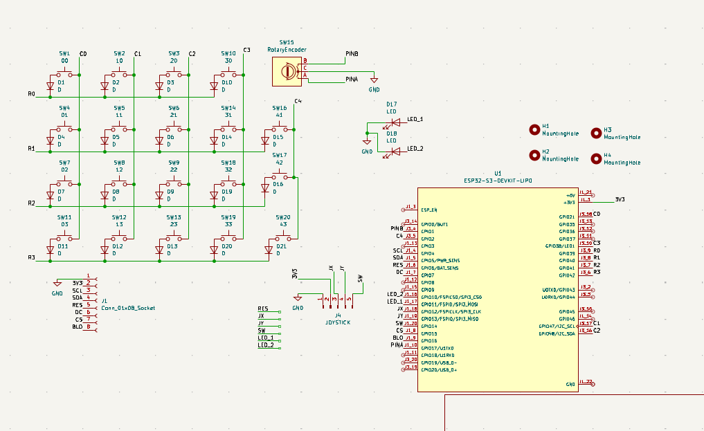
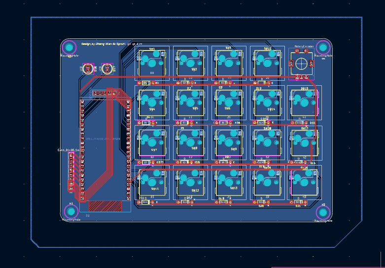
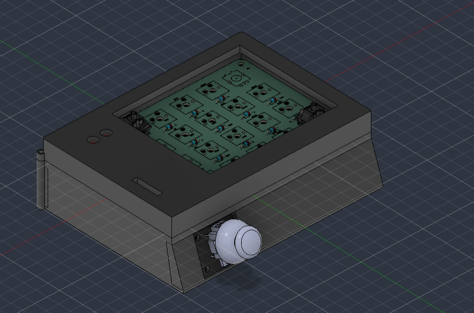

# wowmacropad

wowmacropad is a macropad with a joystick on the side, a screen and a rotary encoder as well as two status leds and is rechargeable!

## Features

- ESP32-S3 powered with bluetooth
- USB-C connection
- joystick placed near thumb
- rotary encoder
- Status LEDs
- tft screen

## Design files

KiCad source files are in [`kicad files/`](kicad%20files/). The schematic and board previews are shown below.

| Schematic | PCB layout | CAD |
| --- | --- | --- |
|  |  |  |

## Manufacturing

Ready-to-upload Gerber and drill files are in [`Production Files/`](Production%20Files/).

For a new or modified board revision, open `breadESP32.kicad_pcb` in KiCad and regenerate fabrication outputs from that board before ordering. Check the board outline and manufacturer design rules against your chosen fabricator.

## Bill of materials

See [`BOM.md`](BOM.md) for the full component list. The TP4056 charger module is external and is not included in this assembly BOM. The project journal is in [`JOURNAL.md`](JOURNAL.md), and the `Firmware/` folder contains a minimal Arduino sketch.
